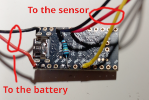
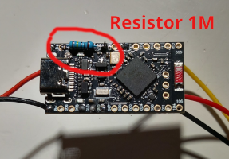

**nRF52840 BTHome Soil Moisture Sensor**  

A low-power CircuitPython firmware for the SuperMini / ProMicro nRF52840 that periodically measures:  
    • 🌱 Soil moisture   
    • 🔋 Battery voltage   
    • 🌡 MCU temperature   
and broadcasts the values as a BTHome v2 Bluetooth Low Energy advertisement.  

The board spends almost all of its time in deep sleep, making it suitable for battery-powered plant sensors.  
The firmware works with Home Assistant through an ESPHome Bluetooth Proxy or any BTHome-compatible receiver.  

**Features**  
    • BTHome v2 BLE advertisements   
    • Optional AES-CCM encryption   
    • Deep sleep between measurements   
    • GPIO-powered soil sensor to minimize standby current   
    • Battery voltage measurement using an external resistor divider   
    • Configurable measurement interval   
    • Fully configurable through config.py   
    • No code changes required for normal configuration   

**Hardware**  
Designed for inexpensive nRF52840 SuperMini / ProMicro boards running CircuitPython.  
Required components:  
    • nRF52840 SuperMini / ProMicro   
    • Capacitive soil moisture sensor   
    • External battery   
    • Two resistors for the battery divider (recommended 1 MΩ + 1 MΩ)  

Example wiring:  

| Signal                   | Board              |  
| ------------------------ | ------------------ |  
| Soil sensor output       | `SOIL_ADC_PIN`     |  
| Soil sensor VCC          | `SENSOR_POWER_PIN` |  
| Soil sensor GND          | GND                |  
| Battery divider midpoint | `BATTERY_ADC_PIN`  |  

 

Battery divider:  

Battery+  
   |  
  R1 (1MΩ)  
   |  
BATTERY_ADC_PIN  
   |  
  R2 (1MΩ)  
   |  
  GND  

The onboard BAT_VOLT input is intentionally not used because on these clone boards it often follows VDD rather than the actual battery voltage when running from battery power.  

**Installation**  
Copy the following files onto the CIRCUITPY drive:   
code.py  
config.py   
If encryption is desired, you can also copy:  
Key_generator.py   
Reset the board after copying the files.  

**Configuration**  
All user settings are contained in config.py.  
Typical settings include:  

    • device name   
    • sleep interval   
    • advertising duration   
    • GPIO pin assignments   
    • battery calibration   
    • soil moisture calibration   
    • low battery threshold   
    • low moisture threshold   
    • BTHome encryption   

Normally there is no need to modify code.py.  

**BTHome Encryption**  
Encryption is optional but recommended.  

Enable it by setting: ENCRYPT = True  

Generate a random 16-byte key with:  
import os  
print(os.urandom(16).hex())  

or simply run: Key_generator.py  

Copy the generated key into: ENCRYPTION_KEY = bytes.fromhex("...")  

The same key must be entered as the Bindkey when adding the device to Home Assistant.  

**Battery Calibration**  
The firmware measures battery voltage through an external resistor divider.   

Recommended divider:  
    • R1 = 1 MΩ   
    • R2 = 1 MΩ   

Configure:  
BATTERY_DIVIDER_RATIO = 2  
If necessary, fine-tune: BATTERY_SCALE and BATTERY_OFFSET, using a multimeter.  
Calibration should always be performed while powered from the battery (USB disconnected).  

**Soil Moisture Calibration**  
First determine the raw ADC values.  
Measure:  
    • probe completely dry   
    • probe fully submerged in water   
Then set:  
DRY_VAL = ...  
WET_VAL = ...  
If small corrections are still required, use: HUMIDITY_SCALE and HUMIDITY_OFFSET  

**GPIO Powered Sensor**  
The soil sensor is powered from a GPIO pin instead of permanently from the battery.  
During each measurement cycle the firmware:  
    1. powers the sensor   
    2. waits for stabilization   
    3. performs the ADC measurements   
    4. powers the sensor off   
    5. enters deep sleep   
This significantly reduces standby current.  

**Home Assistant**  
The firmware broadcasts standard BTHome v2 advertisements containing:  
    • Soil moisture (%)   
    • Battery voltage (V)   
    • MCU temperature (°C)   
    • Low moisture binary sensor   
    • Low battery binary sensor   
Encrypted advertisements are fully compatible with Home Assistant by providing the configured Bindkey.  

**Power Consumption**  
Current consumption depends on:  
    • sleep interval   
    • advertising duration   
    • board revision   
    • soil sensor used   
Increasing SLEEP_S can greatly extend battery life.  

**Included Files**  
| File               | Description                                      |  
| ------------------ | ------------------------------------------------ |  
| `code.py`          | Main firmware                                    |  
| `config.py`        | User configuration                               |  
| `Key_generator.py` | Generates a random 16-byte BTHome encryption key |  
 

License  
MIT License  